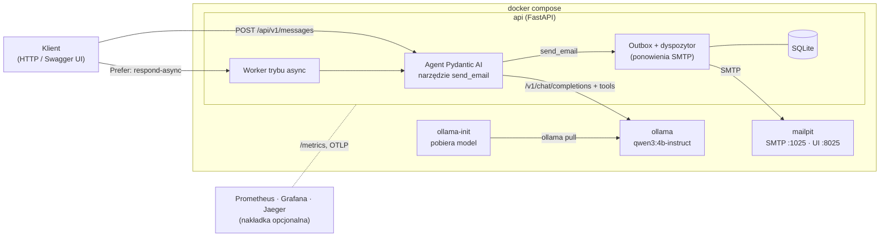

# AI Message Router

Usługa HTTP, która przyjmuje zgłoszenie pracownika w dowolnej formie („Nie działa mi komputer”,
„Chciałbym zgłosić urlop na jutro”) i przekazuje je e-mailem do właściwego działu. Decyzję podejmuje
agent oparty na lokalnym modelu językowym (Ollama, `qwen3:4b-instruct`), a wiadomość wysyła wyłącznie
przez wywołanie narzędzia `send_email` (function calling). Mail ma ustawiony `Reply-To` na adres
nadawcy, więc dział odpowiada bezpośrednio zgłaszającemu.

- Python 3.13, FastAPI, Pydantic AI, Ollama, SQLite, Docker Compose; całość działa lokalnie na CPU.
- Każde zgłoszenie jest zapisywane, a mail trafia do transakcyjnego outboxu, więc awaria SMTP nie gubi
  wiadomości.
- Tryb synchroniczny i asynchroniczny (`Prefer: respond-async`), idempotencja, uwierzytelnianie kluczem
  API albo OIDC, limity zapytań per klient.
- Polityka działów w YAML jako jedno źródło dla promptu, schematu narzędzia, OpenAPI i testów.
- Metryki Prometheus, dashboard Grafany, alerty, ślady OpenTelemetry.
- 223 testy automatyczne i ewaluacja jakości na 158 opisanych przypadkach: trafność 98,1%
  (95% CI 94,6–99,4%).

## Architektura



| Usługa | Obraz | Rola | Port hosta |
|---|---|---|---|
| `api` | `python:3.13-slim` (`api/Dockerfile`) | API, agent, worker, outbox | 8080 |
| `ollama` | `alpine/ollama:0.40.3` | Serwer modelu (CPU) | 11435 |
| `ollama-init` | jak `ollama` | Jednorazowe, idempotentne pobranie modelu | — |
| `api-ready` | jak `api` | Bramka startowa: `up -d` kończy się przy gotowym API | — |
| `mailpit` | `axllent/mailpit:v1.31.5` | Przechwytujący serwer SMTP z panelem WWW | 8025 |

Obrazy są przypięte tagiem i digestem, porty publikowane tylko na `127.0.0.1`. Szczegóły:
[docs/DESIGN.md](docs/DESIGN.md).

## Uruchomienie

Wymagania: Docker Engine ≥ 25 z Compose ≥ 2.24, ok. 8 GB RAM i 5 GB miejsca na dysku dla Dockera.
Pierwsze uruchomienie pobiera model (ok. 2,5 GB); kolejne działają offline.

```bash
git clone https://github.com/miikoolaj/systemem-AI-kategoryzacji-i-routingu-wiadomo-ci.git ai-router
cd ai-router
docker compose up -d
```

Polecenie kończy się, gdy model jest pobrany, a API przechodzi healthcheck gotowości. Postęp
pobierania: `docker compose logs -f ollama-init`. Plik `.env` jest opcjonalny.

| | Adres |
|---|---|
| Swagger UI | http://localhost:8080/api/v1/docs |
| OpenAPI | http://localhost:8080/api/v1/openapi.json |
| Mailpit | http://localhost:8025 |
| Metryki | http://localhost:8080/metrics |

`docker compose down` zatrzymuje stos z zachowaniem modelu i bazy, `docker compose down -v` usuwa też
wolumeny. Skróty do typowych zadań: `make help`.

## Przykład

```bash
curl -s --max-time 200 -X POST http://localhost:8080/api/v1/messages \
  -H 'Content-Type: application/json' \
  -d '{"email": "jan.nowak@example.com", "message": "Nie działa mi komputer"}' | jq
```

```json
{
  "ticket_code": "AIR-765A3A02",
  "status": "routed",
  "routed_by": "agent",
  "department": "help-desk@example.com",
  "reason": "Problem z komputerem jednej osoby",
  "confidence": 0.99,
  "needs_review": false,
  "email": {
    "subject": "[AI Router] [AIR-765A3A02] Komputer nie działa",
    "to": "help-desk@example.com",
    "reply_to": "jan.nowak@example.com",
    "delivery": "sent"
  },
  "diagnostics": {"agent_mode": "tool", "llm_requests": 2, "tool_calls": 1, "duration_ms": 12340}
}
```

Odpowiedź skrócona; pełny schemat jest w Swaggerze. Na CPU zapytanie trwa zwykle 10–15 s. Klient,
który nie chce czekać, wysyła nagłówek `Prefer: respond-async` i dostaje `202` z nagłówkiem
`Location` (`GET /api/v1/messages/{ticket_id}`). Nagłówek `Idempotency-Key` chroni przed drugim
mailem przy ponowieniu zapytania.

Mail jest widoczny w Mailpit w skrzynce działu, z nagłówkami `Reply-To`, `X-Request-ID` i
`X-AI-Router-*`. `./scripts/smoke-test.sh` (`make smoke`) sprawdza cały przepływ automatycznie.

## Działy

Lista zawiera dwie pary działów o zbliżonym zakresie (HR / kadry, help-desk / IT). Rozdzielam je
funkcjonalnie, niezależnie od języka wiadomości:

| Dział | Zakres | Przykład |
|---|---|---|
| `kadry@example.com` | Administracja kadrowo-płacowa: urlopy, L4, czas pracy, wynagrodzenia, umowy, zaświadczenia | „Chciałbym zgłosić urlop na jutro” |
| `human-resources@example.com` | Rekrutacja, onboarding, szkolenia, benefity, oceny, konflikty, dobrostan | „Jakie szkolenia są dostępne?” |
| `help-desk@example.com` | Problem jednej osoby z jej sprzętem, kontem lub programem | „Nie działa mi komputer” |
| `it@example.com` | Awarie wielu użytkowników, bezpieczeństwo, uprawnienia do systemów, wdrożenia | „Serwer nie odpowiada, cały dział stoi” |
| `other@example.com` | Treści niejasne, niezwiązane z działami, spam; fallback | „Gdzie mogę zaparkować rower?” |

Polityka jest zdefiniowana w
[api/src/ai_router/routing/policy.yaml](api/src/ai_router/routing/policy.yaml) (zakres, wyłączenia,
słowa kluczowe, przykłady, reguły rozstrzygania) i walidowana przy starcie. Własną politykę można
podmienić bez przebudowy obrazu: [config/README.md](config/README.md).

## Jak działa routing

1. API waliduje zgłoszenie, zapisuje je w bazie i uruchamia agenta (w trybie async robi to worker).
2. Model dostaje instrukcje z polityki, treść wiadomości jako dane i schemat narzędzia `send_email`, w
   którym dział jest enumem dozwolonych adresów.
3. Model zwraca wywołanie `send_email(reason, department, confidence, subject)`. Pydantic AI waliduje
   argumenty i przy błędzie odsyła go modelowi do poprawy.
4. Narzędzie składa maila i zapisuje go w outboxie. `Reply-To`, oryginalną treść i numer zgłoszenia
   wstawia kod, nie model, więc prompt injection nie może ich zmienić.
5. Dyspozytor wysyła mail przez SMTP i ponawia próby, gdy serwer jest niedostępny.

Gwarancje wynikające z tego układu:

- Mail wysyła tylko narzędzie. Gdy model odpowie samym tekstem, walidator wyjścia wymusza wywołanie.
- Jedno zgłoszenie daje dokładnie jeden mail: narzędzie blokuje powtórne wywołania, a outbox jest
  kluczowany numerem zgłoszenia.
- Wynik API pochodzi z rekordu w outboxie, nie z tekstu modelu. Timeout po przekazaniu maila nie
  powoduje drugiej wysyłki przez fallback.
- Gdy agent zawiedzie (model niedostępny, timeout, wyczerpane ponowienia), zgłoszenie trafia do
  `other@example.com` z oznaczeniem `routed_by: "fallback"`.
- Decyzje z pewnością poniżej progu (`CONFIDENCE_THRESHOLD`) dostają w temacie `[Do weryfikacji]`.
  Każdy mail zawiera podpisany link „Zły dział?”, a zebrane korekty eksportują się jako nowe przypadki
  do zbioru ewaluacyjnego.

## Wyniki

Ewaluacja `make eval` na 158 przypadkach (polski, angielski, niemiecki, ukraiński, przypadki
kontrastowe, slang, 10 prób prompt injection, 52 przypadki holdout), `qwen3:4b-instruct-2507-q4_K_M`
na CPU:

| Konfiguracja | Trafność (95% CI) | Holdout | Wywołanie narzędzia | p50 / p95 |
|---|---|---|---|---|
| `AGENT_MODE=tool`, polityka `2026-10-13.2` | 94,9% (90,3–97,4%) | 49/52 | 100% | 12,3 / 15,3 s |
| `AGENT_MODE=output_function`, polityka `.2` | 94,9% (90,3–97,4%) | 49/52 | 100% | 9,1 / 12,1 s |
| `AGENT_MODE=tool`, polityka `.3` (domyślna) | **98,1% (94,6–99,4%)** | **50/52** | 100% | 12,8 / 16,3 s |

Polityka `.3` doprecyzowała granice HR, przeniosła wymóg języka do opisów parametrów narzędzia (sama
reguła w instrukcjach była ignorowana) i ustawiła polski jako domyślny język tematu maila. Zmiany
wynikały wyłącznie z błędów na zbiorze strojeniowym; szczegóły błędów na holdout raport ukrywa, żeby
nie stroić promptu pod przypadki kontrolne.

Raporty: [eval-results/](eval-results/). Wydajność na AMD Ryzen 7 5800H (8 wątków, bez GPU): mediana
12,7 s na zgłoszenie, ok. 5 zgłoszeń na minutę. Większość czasu zajmuje pierwsze zapytanie do modelu.
Tryb `output_function` pomija drugą rundę i jest o ok. 3 s szybszy przy tej samej trafności.

Model deklaruje pewność 0,9–1,0 także przy błędnych decyzjach, więc przy tym modelu próg pewności
rzadko się uruchamia. Pomyłki wyłapuje przede wszystkim informacja zwrotna od działów.

## Testy

Testy działają w kontenerze deweloperskim; na hoście nie jest potrzebny Python.

| Polecenie | Zakres |
|---|---|
| `make test` | Testy jednostkowe, API, kontraktowe (format zapytań do Ollamy) i właściwości (Hypothesis), ok. 20 s |
| `make lint` | `ruff` i `mypy --strict` |
| `make e2e` | Pełny przepływ przez HTTP na prawdziwym modelu: API → Ollama → Mailpit |
| `make e2e-fake` | To samo na deterministycznym modelu regułowym, bez Ollamy |
| `make eval` | Ewaluacja trafności z progami jakości |
| `make bench` / `make load` | Pomiar czasu odpowiedzi / test obciążeniowy |
| `make scan` | Skan obrazu Trivy |

CI (GitHub Actions) uruchamia lint, testy z progiem pokrycia 90%, E2E na modelu regułowym i skan
Trivy. Osobny workflow uruchamia ewaluację na prawdziwym modelu z progami jakości.

## Konfiguracja

Wszystkie zmienne mają wartości domyślne, a niespójna konfiguracja zatrzymuje start z komunikatem
wskazującym zmienną. Pełna lista: [.env.example](.env.example). Najważniejsze:

| Zmienna | Domyślnie | Opis |
|---|---|---|
| `OLLAMA_MODEL` | `qwen3:4b-instruct-2507-q4_K_M` | Model; po zmianie `docker compose up -d` pobierze nowy |
| `AGENT_MODE` | `tool` | `output_function`: jedno zapytanie do modelu zamiast dwóch |
| `AUTH_MODE` | `none` | `api_key` albo `oidc` przy wystawieniu poza localhost |
| `CONFIDENCE_THRESHOLD` | `0.5` | Próg oznaczenia `[Do weryfikacji]` |
| `ROUTING_POLICY_FILE` | wbudowana | Własna polityka działów |
| `RATE_LIMIT_PER_MINUTE` | `30` | Limit zapytań na klienta |
| `LLM_BACKEND` | `ollama` | `fake`: model regułowy (CI, demo bez pobierania modelu) |

GPU (NVIDIA): `docker compose -f docker-compose.yml -f docker-compose.gpu.yml up -d`. Instalacja bez
dostępu do internetu: `make model-export` i `make model-import`.

## Dokumentacja

- [docs/DESIGN.md](docs/DESIGN.md): architektura, decyzje projektowe, agent i prompt, niezawodność,
  bezpieczeństwo, testy.
- [docs/RUNBOOK.md](docs/RUNBOOK.md): diagnostyka, alerty, aktualizacje, kopie zapasowe, RODO.
- [eval-results/](eval-results/): raporty ewaluacji.

## Ograniczenia

- Jedna instancja API (SQLite, worker i outbox w procesie). Skalowanie poziome wymaga PostgreSQL i
  zewnętrznej kolejki; na CPU przepustowość i tak ogranicza model.
- Jedna wiadomość trafia do jednego działu; przy kilku sprawach wybierana jest główna.
- Mailpit służy do testów. W produkcji `SMTP_HOST` wskazuje serwer firmowy (obsługiwane STARTTLS/TLS i
  uwierzytelnianie).

## Struktura repozytorium

```text
├── docker-compose.yml               # stos: ollama, ollama-init, mailpit, api, api-ready
├── docker-compose.{gpu,observability,ci}.yml
├── api/
│   ├── src/ai_router/
│   │   ├── routing/                 # polityka, prompt, agent, serwis, worker
│   │   ├── mail/                    # kompozycja, SMTP, outbox
│   │   ├── storage/                 # SQLite: zgłoszenia, outbox, idempotencja, feedback
│   │   ├── web/                     # endpointy, schematy, bezpieczeństwo, middleware
│   │   ├── llm/                     # model Ollama, model regułowy, API administracyjne Ollamy
│   │   └── observability/           # metryki, tracing
│   └── tests/                       # unit, api, contract, integration, e2e, eval, perf
├── config/                          # własna polityka routingu (montowane jako /config)
├── observability/                   # Prometheus (alerty), Grafana (dashboard)
├── scripts/                         # init modelu, smoke test, eksport/import modelu
├── docs/                            # DESIGN, RUNBOOK
└── eval-results/                    # raporty ewaluacji
```
