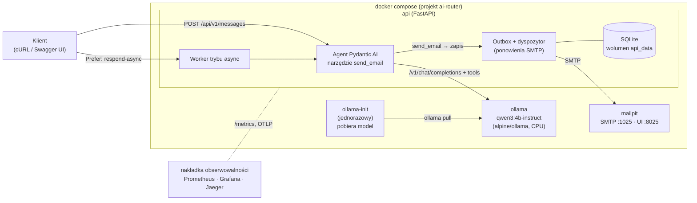
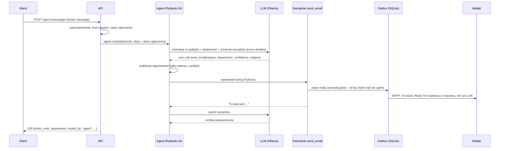

# AI Message Router

Inteligentny router wiadomości: API przyjmuje dowolne zgłoszenie użytkownika („Nie działa mi komputer”,
„Chciałbym zgłosić urlop na jutro”), **agent AI** oparty na lokalnym modelu językowym (Ollama) interpretuje
treść, wybiera właściwy dział i **sam wysyła e-mail, wywołując narzędzie `send_email`** (function calling).
Wiadomość trafia do przechwytującego serwera pocztowego **Mailpit** z nagłówkiem `Reply-To` ustawionym na
adres nadawcy.

Projekt zaczynał jako PoC; druga faza dodała to, czego potrzeba do pracy z prawdziwymi zgłoszeniami:
trwały zapis zgłoszeń i outbox (żaden mail nie ginie przy awarii SMTP), tryb asynchroniczny,
uwierzytelnianie klientów, informację zwrotną od działów, metryki z alertami i śledzenie (tracing).

| Dokument | Dla kogo |
|---|---|
| **README.md** (ten plik) | Uruchomienie, użycie, konfiguracja, decyzje, testy |
| [docs/RUNBOOK.md](docs/RUNBOOK.md) | Utrzymanie: alerty, diagnoza, kopie zapasowe, typowe awarie |
| [docs/DESIGN.md](docs/DESIGN.md) | Pełny projekt systemu (architektura, analiza ryzyk, alternatywy) |

---

## Spis treści

- [Architektura](#architektura)
- [Wymagania](#wymagania)
- [Szybki start](#szybki-start)
- [Przykładowe zapytania](#przykładowe-zapytania)
- [Weryfikacja w Mailpit](#weryfikacja-w-mailpit)
- [Jak działa agent](#jak-działa-agent)
- [Polityka routingu](#polityka-routingu)
- [Niezawodność: zgłoszenia, outbox, tryb asynchroniczny](#niezawodność-zgłoszenia-outbox-tryb-asynchroniczny)
- [Bezpieczeństwo](#bezpieczeństwo)
- [Informacja zwrotna od działów](#informacja-zwrotna-od-działów)
- [Obserwowalność](#obserwowalność)
- [API](#api)
- [Konfiguracja](#konfiguracja)
- [Testy i jakość](#testy-i-jakość)
- [Decyzje architektoniczne](#decyzje-architektoniczne)
- [Rozwiązywanie problemów](#rozwiązywanie-problemów)
- [Ograniczenia](#ograniczenia)
- [Struktura repozytorium](#struktura-repozytorium)

---

## Architektura



| Usługa | Obraz | Rola | Adres na hoście |
|---|---|---|---|
| `api` | `python:3.13-slim` (build z `api/Dockerfile`, bez `pip`, użytkownik nie-root) | Endpointy HTTP, agent AI, worker, outbox, Swagger | http://localhost:8080 |
| `ollama` | `alpine/ollama:0.40.3` (121 MB, tylko CPU) | Lokalny silnik LLM | http://localhost:11435 (debug) |
| `ollama-init` | jak `ollama` | Jednorazowo pobiera model (opcjonalnie weryfikuje digest wag) | — |
| `api-ready` | obraz `api` | Bramka startowa: `docker compose up -d` wraca dopiero przy gotowym API | — |
| `mailpit` | `axllent/mailpit:v1.31.5` | Przechwytuje e-maile, panel WWW, REST API, retencja 7 dni | http://localhost:8025 |

Wszystkie obrazy są przypięte tagiem **i digestem**; aktualizacje proponuje Renovate. Porty są publikowane
tylko na `127.0.0.1`. API ma na hoście port **8080** (8000 bywa zajęty), Ollama **11435** (żeby nie
kolidować z lokalną Ollamą na 11434). Porty zmienisz w `.env`.

**Dlaczego `alpine/ollama`?** To ta sama Ollama skompilowana tylko dla CPU: 121 MB zamiast 9,4 GB
(biblioteki CUDA/ROCm). Pomiar na tej samej maszynie: ok. 8 tok/s w obu obrazach, bo oba ładują ten sam
backend CPU (AVX2). Dla GPU jest nakładka `docker-compose.gpu.yml` z pełnym obrazem.

## Wymagania

- Docker Engine ≥ 25 i Docker Compose ≥ 2.24 (`docker version`, `docker compose version`)
- ≥ 8 GB RAM dla Dockera (model ok. 2,5 GB + cache kontekstu ok. 1,2 GB); na Docker Desktop zwiększ limit
- ≥ 5 GB wolnego dysku (obrazy ok. 0,6 GB, model ok. 2,5 GB)
- Internet przy **pierwszym** uruchomieniu (kolejne działają offline, łącznie ze Swaggerem)
- Opcjonalnie: `curl`, `jq`, `make`

## Szybki start

```bash
git clone <adres-repozytorium> ai-router
cd ai-router
docker compose up -d
```

To wszystko. Pierwsze uruchomienie pobiera obrazy i model (ok. 2,5 GB). Polecenie **czeka**, aż model
będzie na dysku, a API przejdzie healthcheck gotowości. **Gdy polecenie się zakończy, API przyjmuje
zapytania.** Postęp pobierania: `docker compose logs -f ollama-init`.

Zaraz po starcie API w tle ładuje model i wypełnia cache promptu (ok. 40 s na CPU). Zapytanie wysłane w
tym czasie poczeka na koniec rozgrzewki; później jedno zgłoszenie trwa ok. 12 s (pomiar niżej). Gdy
Ollama zostanie zrestartowana osobno, API samo wykryje utratę modelu i rozgrzeje go ponownie.

| Co | Adres |
|---|---|
| Swagger UI (dokumentacja API, działa offline) | http://localhost:8080/api/v1/docs |
| ReDoc | http://localhost:8080/api/v1/redoc |
| Specyfikacja OpenAPI | http://localhost:8080/api/v1/openapi.json |
| Panel Mailpit (przechwycone e-maile) | http://localhost:8025 |
| Metryki Prometheus | http://localhost:8080/metrics |

Zatrzymanie: `docker compose down` (model i zgłoszenia zostają w wolumenach). Pełny reset:
`docker compose down -v`. Wszystkie skróty: `make help`.

## Przykładowe zapytania

```bash
curl -s --max-time 200 -X POST http://localhost:8080/api/v1/messages \
  -H 'Content-Type: application/json' \
  -d '{"email": "jan.nowak@example.com", "message": "Nie działa mi komputer"}' | jq
```

Przykładowa odpowiedź (`200 OK`):

```json
{
  "ticket_id": "765a3a02c1e04f6f9a3b2d18e4c7f501",
  "ticket_code": "AIR-765A3A02",
  "request_id": "6b1f0c7e-3f2a-4d55-9a57-6f3e0d2b9c11",
  "status": "routed",
  "routed_by": "agent",
  "department": "help-desk@example.com",
  "chosen_department": "help-desk@example.com",
  "reason": "Problem z komputerem jednej osoby",
  "confidence": 0.99,
  "needs_review": false,
  "sender_verification": "none",
  "email": {
    "message_id": "<179191058065.1.7366@ai-router.local>",
    "subject": "[AI Router] [AIR-765A3A02] Komputer nie działa",
    "to": "help-desk@example.com",
    "reply_to": "jan.nowak@example.com",
    "delivery": "sent"
  },
  "diagnostics": {
    "model": "qwen3:4b-instruct-2507-q4_K_M",
    "agent_mode": "tool",
    "prompt_version": "3188bf7a",
    "llm_requests": 2,
    "tool_calls": 1,
    "tool_duplicates": 0,
    "retries": 0,
    "input_tokens": 2949,
    "output_tokens": 67,
    "duration_ms": 12340,
    "queue_wait_ms": 0
  },
  "warnings": []
}
```

Inne przykłady:

```bash
# -> kadry@example.com
curl -s --max-time 200 -X POST http://localhost:8080/api/v1/messages -H 'Content-Type: application/json' \
  -d '{"email": "anna.kowalska@example.com", "message": "Chciałbym zgłosić urlop na jutro"}' | jq '{department, reason}'

# -> it@example.com
curl -s --max-time 200 -X POST http://localhost:8080/api/v1/messages -H 'Content-Type: application/json' \
  -d '{"email": "piotr@example.com", "message": "Serwer z bazą danych nie odpowiada, cały dział stoi"}' | jq '{department, reason}'

# Tryb asynchroniczny: 202 od razu, wynik pod adresem z nagłówka Location
curl -si -X POST http://localhost:8080/api/v1/messages -H 'Content-Type: application/json' \
  -H 'Prefer: respond-async' \
  -d '{"email": "ewa@example.com", "message": "Gdzie mogę zaparkować rower?"}' | grep -i '^location'
curl -s http://localhost:8080/api/v1/messages/<ticket_id> | jq '{status, department: .result.department}'
```

Na CPU zapytanie synchroniczne trwa zwykle **10–15 s**, stąd `--max-time 200`. Nagłówek
`Idempotency-Key: <klucz>` sprawia, że powtórzenie zapytania (np. po zerwanym połączeniu) zwróci zapisany
wynik zamiast wysyłać drugi mail.

## Weryfikacja w Mailpit

1. Otwórz http://localhost:8025. Wiadomość leży w skrzynce adresata (np. `help-desk@example.com`).
2. W wiadomości zobaczysz odbiorcę `To`, a na zakładce **Headers** nagłówek
   `Reply-To: jan.nowak@example.com`, numer zgłoszenia w temacie i nagłówki diagnostyczne `X-Request-ID`
   oraz `X-AI-Router-*` (dział, pewność, wersja promptu, sposób weryfikacji nadawcy).
3. Treść ma wersję tekstową i HTML: baner o weryfikacji nadawcy, uzasadnienie decyzji, oryginalną
   wiadomość i link „Zły dział?” do informacji zwrotnej.

Z terminala:

```bash
curl -s http://localhost:8025/api/v1/message/latest | jq '{To: .To[0].Address, ReplyTo: .ReplyTo[0].Address, Subject}'
```

Automatyczne sprawdzenie wszystkich kryteriów DoD (Swagger, dział, `Reply-To`, `X-Request-ID`, zapis
zgłoszenia, numer w temacie, tryb asynchroniczny):

```bash
./scripts/smoke-test.sh          # lub: make smoke  (wymaga curl i jq)
```

## Jak działa agent



Najważniejsze zasady:

- **Mail wysyła wyłącznie narzędzie agenta.** Model zwraca *prośbę* o wywołanie `send_email`, a aplikacja
  waliduje argumenty i wykonuje funkcję. Jeśli model odpowie samym tekstem, walidator wyjścia
  (`ModelRetry`) każe mu wywołać narzędzie.
- **LLM decyduje, kod wykonuje.** Model wybiera tylko dział (z enuma), temat, uzasadnienie i pewność.
  `Reply-To`, oryginalną treść i nadawcę wstawia kod z danych zgłoszenia, więc prompt injection nie może
  ich zmienić.
- **Źródłem prawdy jest zapis w outboxie, nie tekst modelu.** Odpowiedź API buduje się z rekordu maila.
  Nawet gdy agent przekroczy czas *po* przekazaniu maila do wysyłki, serwis odczyta zapis i nie wyśle
  maila drugi raz przez fallback (test regresyjny `test_service.py`).
- **Dokładnie jeden mail na zgłoszenie.** Narzędzie ma blokadę (duplikaty są liczone w diagnostyce i
  metrykach), a outbox jest kluczowany identyfikatorem zgłoszenia.
- **Pewność decyzji.** Model podaje `confidence` (0–1). Poniżej `CONFIDENCE_THRESHOLD` (domyślnie 0,5)
  mail dostaje w temacie `[Do weryfikacji]`, a odpowiedź `needs_review: true`; opcjonalnie
  (`LOW_CONFIDENCE_ACTION=other`) takie zgłoszenia trafiają do działu fallback. **Zastrzeżenie z
  ewaluacji:** domyślny model 4B deklaruje pewność 0,9–1,0 także przy błędnych decyzjach, więc próg
  rzadko się uruchamia. Mechanizm jest gotowy na lepsze źródło sygnału (większy model, porównanie dwóch
  przebiegów), a do wyłapywania pomyłek służy dziś informacja zwrotna od działów.
- **Fallback.** Jeśli agent zawiedzie (LLM nie odpowiada, wyczerpane ponowienia, timeout), zgłoszenie
  trafia do `other@example.com` z oznaczeniem `routed_by: "fallback"`. Można go wyłączyć
  (`ROUTING_FALLBACK_ENABLED=false`).
- **Dwa tryby agenta.** `AGENT_MODE=tool` (domyślny): narzędzie + krótka odpowiedź modelu, dwa zapytania
  do LLM. `AGENT_MODE=output_function`: wywołanie `send_email` jest jednocześnie wynikiem agenta, jedno
  zapytanie do LLM. Porównanie w sekcji [Testy i jakość](#testy-i-jakość).

## Polityka routingu

Lista działów z zadania zawiera dwie pary nakładających się nazw: **HR / kadry** oraz **help-desk / IT**.
Projekt rozdziela je **funkcjonalnie**, niezależnie od języka wiadomości:

| Dział | Zakres | Przykład |
|---|---|---|
| `kadry@example.com` | administracja kadrowo-płacowa: urlopy, L4, czas pracy, wynagrodzenia, PIT-11, umowy i aneksy, zaświadczenia | „Chciałbym zgłosić urlop na jutro” |
| `human-resources@example.com` | HR „ludzki”: rekrutacja, onboarding, szkolenia, benefity, oceny, konflikty, mobbing, dobrostan | „Jakie szkolenia są dostępne?” |
| `help-desk@example.com` | wsparcie pierwszej linii dla **jednej osoby**: jej komputer, drukarka, hasło, konto, Outlook | „Nie działa mi komputer” |
| `it@example.com` | infrastruktura i systemy: awarie dotykające wielu osób, bezpieczeństwo (phishing), uprawnienia do systemów, wdrożenia, licencje | „Serwer nie odpowiada, cały dział stoi” |
| `other@example.com` | treści niejasne, puste, niezwiązane z działami, spam (fallback) | „Gdzie mogę zaparkować rower?” |

Politykę definiuje jeden plik danych:
[api/src/ai_router/routing/policy.yaml](api/src/ai_router/routing/policy.yaml) (zakres, wyłączenia,
słowa kluczowe, przykłady few-shot, reguły rozstrzygania). Z niego powstają instrukcje agenta, enum w
schemacie narzędzia, opis w Swaggerze i testy. Plik jest walidowany przy starcie (unikalne adresy,
dokładnie jeden fallback, reguły odwołują się tylko do istniejących działów).

**Własna polityka bez przebudowy obrazu:** skopiuj plik do `config/routing-policy.yaml`, ustaw w `.env`
`ROUTING_POLICY_FILE=/config/routing-policy.yaml` i uruchom `docker compose up -d`
(szczegóły: [config/README.md](config/README.md)). Wersja polityki i hash promptu (`prompt_version`)
trafiają do odpowiedzi, nagłówków maili, metryk i raportów ewaluacji.

## Niezawodność: zgłoszenia, outbox, tryb asynchroniczny

- **Każde zgłoszenie jest zapisywane** (SQLite w wolumenie `api_data`) z numerem `AIR-XXXXXXXX`.
  Status sprawdzisz przez `GET /api/v1/messages/{ticket_id}`.
- **Transakcyjny outbox.** Narzędzie agenta zapisuje gotowy mail w bazie, a dyspozytor wysyła go przez
  SMTP. Gdy SMTP nie działa, mail czeka i jest ponawiany z wykładniczym odstępem (do 12 prób,
  maks. 5 min przerwy). Odpowiedź ma wtedy `email.delivery: "queued"` zamiast błędu 503, a metryka
  `ai_router_outbox_pending` i alert `AiRouterOutboxBacklog` pokazują zaległości.
- **Tryb asynchroniczny** (`Prefer: respond-async`): `202 Accepted` z nagłówkiem `Location` od razu,
  przetwarzanie w tle przez worker. Dla klientów, którzy nie chcą trzymać połączenia 10+ sekund.
- **Restart nie gubi pracy.** Po starcie API przerwane zgłoszenia asynchroniczne wracają do kolejki
  (synchroniczne dostają status `failed`, bo klient i tak stracił połączenie), a niewysłane maile
  wracają do outboxu.
- **Idempotencja** (`Idempotency-Key`) jest trwała (24 h) i rozdzielona per klient.
- **Retencja danych:** zgłoszenia 30 dni, informacja zwrotna 180 dni, maile w Mailpit 7 dni
  (zmienne `TICKET_RETENTION_DAYS`, `FEEDBACK_RETENTION_DAYS`, `MAILPIT_MAX_AGE`).

## Bezpieczeństwo

| Mechanizm | Opis |
|---|---|
| Uwierzytelnianie (`AUTH_MODE`) | `none` (domyślnie, tylko localhost), `api_key` (nagłówek `X-API-Key`, w konfiguracji tylko skróty SHA-256 kluczy; `make api-key` generuje klucz), `oidc` (token Bearer JWT z firmowego SSO, weryfikacja podpisu przez JWKS, `aud`, `iss`, `exp`) |
| Weryfikacja nadawcy | Przy `oidc` pole `email` musi zgadzać się z tokenem (inaczej 403), więc nie da się podszyć pod kogoś w `Reply-To`. Każdy mail ma baner: nadawca niezweryfikowany / przekazany przez system kliencki / zweryfikowany przez SSO |
| Limit zapytań | Token bucket per klient (klucz API, użytkownik SSO albo IP): 30/min, zryw 10; 429 z `Retry-After` |
| Prompt injection | Treść jest danymi (escapowana, w znacznikach), adresy tylko z enuma, `Reply-To` i treść z kodu, reguła ignorowania poleceń w wiadomości; zbiór ewaluacyjny zawiera 10 prób ataku |
| Dane osobowe | Logi bez treści wiadomości (domyślnie), ślady bez treści promptów (`TRACE_INCLUDE_CONTENT=false`), retencja w bazie i w Mailpit |
| Obraz | Użytkownik nie-root, bez `pip`, skan Trivy (`make scan`): 0 podatności HIGH/CRITICAL |
| Panel informacji zwrotnej | Linki podpisane HMAC; eksport danych tylko z `ADMIN_TOKEN` |

## Informacja zwrotna od działów

Każdy mail zawiera link „Zły dział? Kliknij i wskaż właściwy” (podpisany HMAC, bez logowania). Pracownik
działu wybiera właściwy adres w prostym formularzu; korekta trafia do bazy i do metryki
`ai_router_feedback_total`. Eksport korekt jako gotowych przypadków testowych do zbioru ewaluacyjnego:

```bash
curl -s http://localhost:8080/api/v1/feedback/export > nowe-przypadki.yaml
# gdy ustawiono ADMIN_TOKEN (wymagany przy AUTH_MODE innym niż none): -H "Authorization: Bearer $ADMIN_TOKEN"
```

W ten sposób prawdziwe pomyłki modelu stają się testami regresyjnymi (pętla: produkcja → korekta →
zbiór ewaluacyjny → poprawa promptu lub polityki → ewaluacja).

## Obserwowalność

| Sygnał | Gdzie |
|---|---|
| Logi JSON z `request_id`, numerem zgłoszenia, działem, czasem i tokenami | `docker compose logs api` |
| Metryki Prometheus (zapytania, routing per dział, fallbacki, czasy agenta, kolejka, tokeny, outbox, pewność, informacja zwrotna) | http://localhost:8080/metrics |
| Dashboard Grafana (16 paneli) i 6 reguł alertów | `make up-observability` → http://localhost:3000 |
| Ślady OpenTelemetry: HTTP → agent → zapytania do LLM → narzędzie | Jaeger: http://localhost:16686 |

```bash
make up-observability     # stos + Prometheus (:9090), Grafana (:3000), Jaeger (:16686)
```

Alerty (`observability/prometheus/alerts.yml`): odsetek fallbacków > 10% przez 15 min, p95 > 30 s,
zaległości w outboxie, maile, których nie udało się wysłać, dużo decyzji o niskiej pewności, API
niedostępne. Co robić przy każdym alercie: [docs/RUNBOOK.md](docs/RUNBOOK.md).

## API

| Metoda i ścieżka | Opis |
|---|---|
| `POST /api/v1/messages` | Kategoryzacja i przekazanie wiadomości. Body: `{"email": "...", "message": "..."}`. Synchronicznie (200) albo z `Prefer: respond-async` (202 + `Location`) |
| `GET /api/v1/messages/{ticket_id}` | Status i wynik zgłoszenia (`queued`, `processing`, `routed`, `failed`) |
| `GET/POST /api/v1/feedback/{ticket_id}?token=…` | Formularz i zapis informacji zwrotnej (link z maila) |
| `GET /api/v1/feedback/export` | Korekty jako przypadki ewaluacyjne (YAML) |
| `GET /api/v1/health/live` · `/api/v1/health/ready` | Liveness i readiness (Ollama, model z obsługą narzędzi, rozgrzewka, SMTP, baza) |
| `GET /metrics` | Metryki Prometheus |
| `GET /api/v1/docs` · `/api/v1/redoc` · `/api/v1/openapi.json` | Dokumentacja |

Błędy mają format **RFC 9457 Problem Details** (`application/problem+json`) z polem `request_id`:

| Kod | Kiedy |
|---|---|
| 401 | Brak lub zły klucz API / token (przy `AUTH_MODE` innym niż `none`) |
| 403 | `email` niezgodny z zalogowanym użytkownikiem (OIDC) albo brak uprawnień administratora |
| 404 | Nieznane zgłoszenie (także cudze, gdy uwierzytelnianie jest włączone) |
| 409 | To samo `Idempotency-Key` jest właśnie przetwarzane (`Retry-After`) |
| 413 | Ciało requestu > 64 KB |
| 422 | Niepoprawne dane (zły e-mail, pusta lub za długa wiadomość, znak NUL), `Idempotency-Key` z inną treścią |
| 429 | Limit zapytań klienta albo brak wolnego slotu agenta w trybie synchronicznym (`Retry-After`) |
| 502 | Agent nie wysłał maila, a fallback jest wyłączony |
| 503 | LLM niedostępny lub źle skonfigurowany, baza niedostępna |
| 504 | Przekroczony czas agenta, a fallback jest wyłączony |

Każda odpowiedź ma nagłówek `X-Request-ID` (można podać własny), który wraca w nagłówku maila, w logach
i w śladach.

## Konfiguracja

Plik `.env` jest **opcjonalny**: wszystkie zmienne mają wartości domyślne, a błędne kombinacje (np.
`AUTH_MODE=api_key` bez kluczy, za małe okno kontekstu na `MAX_MESSAGE_CHARS`) zatrzymują start z
czytelnym komunikatem. Pełna lista z opisami: [.env.example](.env.example). Najczęściej zmieniane:

| Zmienna | Domyślnie | Opis |
|---|---|---|
| `OLLAMA_MODEL` | `qwen3:4b-instruct-2507-q4_K_M` | Model; po zmianie `docker compose up -d` sam go pobierze |
| `AUTH_MODE` | `none` | `api_key` albo `oidc` przy wystawieniu poza localhost |
| `AGENT_MODE` | `tool` | `output_function` = jedno zapytanie do LLM zamiast dwóch |
| `CONFIDENCE_THRESHOLD` / `LOW_CONFIDENCE_ACTION` | `0.5` / `flag` | Próg pewności i co zrobić poniżej (`flag` albo `other`) |
| `MAIL_SUBJECT_LANGUAGE` | `pl` | Język tematu i uzasadnienia w mailu: `pl` (czytają je polskie działy) albo `auto` (język wiadomości) |
| `ROUTING_POLICY_FILE` | wbudowana | Własna polityka działów (YAML) |
| `MAX_CONCURRENT_AGENT_RUNS` | `1` | Równoległe przebiegi agenta (= `OLLAMA_NUM_PARALLEL`) |
| `RATE_LIMIT_PER_MINUTE` | `30` | Limit zapytań na klienta (`0` = wyłączony) |
| `PUBLIC_BASE_URL` | `http://localhost:8080` | Adres API w linkach w mailach |
| `OLLAMA_CONTEXT_LENGTH` | `8192` | Okno kontekstu (domyślne 4096 w Ollamie grozi cichym obcięciem promptu) |
| `LLM_BACKEND` | `ollama` | `fake` = deterministyczne reguły zamiast modelu (CI, demo bez pobierania) |
| `LOG_FORMAT` | `json` | `console` dla czytelnych logów lokalnie |

Zmiana modelu, np. na nowszy `qwen3.5:4b` (model hybrydowy z trybem „myślenia”, który trzeba wyłączyć):

```bash
echo -e "OLLAMA_MODEL=qwen3.5:4b\nLLM_THINKING=false" >> .env
docker compose up -d        # ollama-init pobierze nowy model, api wystartuje z nim
make eval                   # sprawdź trafność przed wdrożeniem
```

Zmierzone na holdout (52 przypadki): `qwen3.5:4b` 98,1% przy medianie 36,9 s, domyślny model 96,2% przy
12,6 s. Na CPU domyślny model jest więc lepszym wyborem; `qwen3.5:4b` ma sens z GPU.

**GPU (NVIDIA)**: `docker compose -f docker-compose.yml -f docker-compose.gpu.yml up -d` (wymaga NVIDIA
Container Toolkit; nakładka używa pełnego obrazu `ollama/ollama`). **Instalacja offline**: `make model-export`
na maszynie z internetem, `make model-import FILE=ollama-models.tgz` na docelowej.

## Testy i jakość

Wszystko działa w kontenerze deweloperskim (profil `dev`), więc na hoście nie potrzebujesz Pythona ani `uv`:

| Komenda | Co robi | Wymaga działającego stosu |
|---|---|---|
| `make test` | 223 testy: jednostkowe, API, kontraktowe (format zapytań do Ollamy na fałszywym serwerze OpenAI), właściwości (Hypothesis); ok. 20 s | nie |
| `make lint` | `ruff` (lint + format) i `mypy --strict` | nie |
| `make test-integration` | Wysyłka SMTP do prawdziwego Mailpit | tak |
| `make test-llm` | Agent na prawdziwym modelu (3 przypadki) | tak |
| `make e2e` | Testy DoD end-to-end przez HTTP (API → Ollama → Mailpit), także tryb async | tak |
| `make e2e-fake` | To samo na deterministycznym fałszywym LLM, bez Ollamy (jak w CI) | nie (startuje własny) |
| `make smoke` | Test dymny w bashu (curl + jq), raport PASS/FAIL | tak |
| `make eval` | Ewaluacja trafności na 158 opisanych przypadkach, raport w `eval-results/` | tak |
| `make bench` / `make load` | Benchmark (10 kolejnych zgłoszeń) / test obciążeniowy | tak |
| `make scan` | Skan podatności obrazu (Trivy) | nie |

**CI** (GitHub Actions, [.github/workflows](.github/workflows)): lint, testy, build obrazu, skan Trivy i
E2E na fałszywym LLM przy każdym pushu; co noc ewaluacja na prawdziwym modelu z progami jakości
(trafność ≥ 90%, tool-compliance ≥ 98%, duplikaty ≤ 5%) dla dwóch wersji Ollamy. Renovate pilnuje
digestów obrazów i zależności, pre-commit uruchamia ruff przed commitem.

**Wyniki ewaluacji** (`qwen3:4b-instruct-2507-q4_K_M`, CPU; 158 przypadków: polskie, angielskie,
niemieckie i ukraińskie wiadomości, przypadki kontrastowe, slang, 10 prób prompt injection, 52 przypadki
holdout; raporty w [eval-results/](eval-results/)):

| Przebieg | Trafność (95% CI Wilsona) | Holdout | Tool-compliance | Duplikaty | Temat po polsku | p50 / p95 |
|---|---|---|---|---|---|---|
| `tool`, polityka `.2` | 94,9% (90,3–97,4%) | 94,2% (49/52) | 100% | 0% | — ¹ | 12,3 / 15,3 s |
| `output_function`, polityka `.2` | 94,9% (90,3–97,4%) | 94,2% (49/52) | 100% | 0% | — ¹ | 9,1 / 12,1 s |
| **`tool`, polityka `.3` (iteracja 2, domyślna)** | **98,1% (94,6–99,4%)** | **96,2% (50/52)** | 100% | 0% | **99,4%** | 12,8 / 16,3 s |

¹ W przebiegach z polityką `.2` obowiązywał język wiadomości; dla polskich wiadomości 74% uzasadnień
i 30% tematów było mimo to po angielsku.

Iteracja 2 zmieniła trzy rzeczy, wyłącznie na podstawie błędów ze zbioru strojeniowego: granice HR
(model „ściągał” do HR sprawy kadrowe i niezwiązane z pracą), wymóg języka w opisach parametrów narzędzia
(sama reguła w instrukcjach była ignorowana) i domyślny język polski. Pozostałe błędy to dwie sprawy
kadrowe z holdout i jedna próba prompt injection. Model deklaruje pewność 0,9–1,0 także przy błędach,
więc próg pewności przy tym modelu niczego nie wyłapuje.

**Wydajność** (CPU AMD Ryzen 7 5800H, 8 wątków dla Ollamy, bez GPU): 10 kolejnych zgłoszeń przez API,
mediana 12,7 s, p95 14,0 s; model generuje ok. 8 tokenów/s. Ok. trzech czwartych czasu zajmuje pierwsze
zapytanie do LLM (wybór działu i argumentów), resztę (2,6–3 s) krótkie potwierdzenie po wykonaniu
narzędzia, którego tryb `output_function` nie potrzebuje (mediana 9,1 s w ewaluacji).

## Decyzje architektoniczne

| # | Decyzja | Uzasadnienie (skrót) |
|---|---|---|
| D1 | **Python 3.13 + FastAPI** | Najbogatszy ekosystem AI; Swagger/OpenAPI generowany z modeli Pydantic; asynchroniczne I/O pasuje do długich wywołań LLM i SMTP. |
| D2 | **Pydantic AI** jako framework agenta | Typowane zależności (`deps`) wstrzykiwane do narzędzi, walidacja argumentów z automatycznym odesłaniem błędu do modelu, walidatory wyjścia, limity, `FunctionModel` do testów bez LLM, wbudowana instrumentacja OpenTelemetry. |
| D3 | **Mailpit** zamiast MailHog | MailHog nie jest rozwijany od 2020 r. Mailpit jest aktywny, ma healthcheck, REST API i retencję. Porty identyczne (1025/8025). |
| D4 | **Init-kontener `ollama-init`** | `docker compose up -d` czeka na wagi modelu; skrypt jest idempotentny, działa offline i opcjonalnie weryfikuje digest wag. |
| D5 | Model **`qwen3:4b-instruct-2507-q4_K_M`** | Tool calling, dobry polski, bez trybu „thinking” (przewidywalne opóźnienie na CPU), 2,5 GB; przypięty tag. Zmiana modelu to jedna zmienna. |
| D6 | **Dział jako płaski enum w schemacie narzędzia** | Model widzi tylko dozwolone adresy; halucynacje odrzuca walidacja i wracają do modelu. Płaski schemat, bo parser Ollamy gubi `$ref`/`anyOf`/`const`. |
| D7 | **`Reply-To` i treść oryginalna z kodu** | Odporność na błędy modelu i prompt injection. |
| D8 | **`@agent.tool` + walidator wyjścia** (domyślnie) | Kanoniczny wzorzec „agent używa narzędzia”, dosłownie zgodny z wymaganiem; `output_function` jako szybszy wariant. |
| D9 | **Synchronicznie i asynchronicznie** | Domyślnie natychmiastowa odpowiedź z działem; `Prefer: respond-async` dla klientów, którzy nie chcą czekać. |
| D10 | **Transakcyjny outbox w SQLite** | Mail zapisany = mail dostarczony (z ponowieniami); jeden plik w wolumenie, zero dodatkowych usług. Przy wielu replikach API: PostgreSQL. |
| D11 | **Polityka działów w YAML** | Zmiana działów bez kodu i bez przebudowy obrazu; walidacja przy starcie; jedno źródło dla promptu, schematu, Swaggera i testów. |
| D12 | **`alpine/ollama`** | Ta sama wydajność na CPU, obraz 77 razy mniejszy (121 MB zamiast 9,36 GB); GPU w nakładce. |
| D13 | **Bramka startowa `api-ready`** | `docker compose up -d` wraca dopiero przy gotowym API. |
| D14 | **Metryki + ślady zamiast tylko logów** | Spadek jakości (fallbacki, niska pewność, korekty działów) i wydajności widać na dashboardzie i w alertach, a nie dopiero w skargach użytkowników. |

Wnioski z testów na prawdziwym modelu:

- **Schemat narzędzia musi być płaski.** Pydantic opisuje enum przez `$ref`/`anyOf`/`const`, a parser
  narzędzi Ollamy tych pól nie obsługuje: lista działów po cichu znikała. Test kontraktowy pilnuje teraz
  dokładnego formatu zapytania wysyłanego do Ollamy.
- **Ollama ignoruje `max_completion_tokens`.** Bez nadpisania profilu modelu limit tokenów nie działał.
- **„Nie rób X” potrafi wywołać X.** Reguła „never call `send_email` more than once” sprawiała, że model
  emitował to samo wywołanie w pętli. Gwarancję „dokładnie raz” zapewnia kod, nie prompt.
- **`OLLAMA_KEEP_ALIVE=-1` w API musi być liczbą.** Zmienna środowiskowa serwera przyjmuje „-1”, ale pole
  `keep_alive` w JSON tylko liczbę albo czas z jednostką („-1” jako tekst daje 400).
- **Ustawienie `thinking` potrafi zniknąć po drodze.** Pydantic AI przekazuje je tylko dla profili, które
  deklarują obsługę „myślenia”. Bez nadpisania profilu `LLM_THINKING=false` było ignorowane, a
  `qwen3.5:4b` „myślał” do limitu tokenów i nie wywoływał narzędzia. Test kontraktowy pilnuje teraz
  `reasoning_effort`.

## Rozwiązywanie problemów

| Objaw | Rozwiązanie |
|---|---|
| `docker compose up -d` długo „wisi” przy pierwszym uruchomieniu | To pobieranie modelu: `docker compose logs -f ollama-init` |
| `port is already allocated` | Zmień port w `.env`, np. `API_PORT=8090` |
| Start API kończy się błędem walidacji | Komunikat wskazuje zmienną (np. `AUTH_MODE=api_key requires API_KEYS`) |
| Odpowiedzi trwają bardzo długo | Sprawdź `docker stats`, metrykę `ai_router_queue_wait_seconds` (kolejka) i panel „Agent duration”; rozważ GPU lub `AGENT_MODE=output_function` |
| `email.delivery: "queued"` | SMTP chwilowo niedostępny; mail zostanie wysłany automatycznie (`ai_router_outbox_pending`) |
| `routed_by: "fallback"` w odpowiedzi | Agent zawiódł; przyczyna w `warnings`, szczegóły w `docker compose logs api` |
| 429 | Limit zapytań klienta albo zajęty slot agenta; użyj `Retry-After` lub trybu async |
| Readiness 503 | `curl -s localhost:8080/api/v1/health/ready \| jq` pokaże, która zależność nie działa |
| `/bin/sh^M: not found` w `ollama-init` (Windows) | Końce linii CRLF: `git config core.autocrlf false` i ponowne klonowanie |

Więcej scenariuszy (z poleceniami diagnostycznymi): [docs/RUNBOOK.md](docs/RUNBOOK.md).

## Ograniczenia

- Jeden proces API (SQLite, worker i outbox w procesie). Skalowanie poziome wymaga PostgreSQL i
  zewnętrznej kolejki; przepustowość ogranicza i tak LLM na CPU (ok. 5 zgłoszeń/min).
- Mały model (4B) myli się w przypadkach naprawdę niejednoznacznych; temu służą próg pewności,
  oznaczenie `[Do weryfikacji]`, uzasadnienie w mailu i pętla informacji zwrotnej.
- Jedna wiadomość = jeden dział (wiadomości z kilkoma sprawami trafiają do działu sprawy głównej).
- Mailpit to narzędzie testowe; produkcyjnie `SMTP_HOST` wskazuje firmowy serwer (STARTTLS/TLS i
  uwierzytelnianie są obsługiwane).

Możliwe dalsze kroki: [docs/DESIGN.md §20](docs/DESIGN.md#20-możliwe-rozszerzenia).

## Struktura repozytorium

```text
.
├── docker-compose.yml               # pełne środowisko
├── docker-compose.gpu.yml           # nakładka NVIDIA (pełny obraz ollama/ollama)
├── docker-compose.observability.yml # Prometheus, Grafana, Jaeger
├── docker-compose.ci.yml            # fałszywy LLM, bez Ollamy (CI, e2e-fake)
├── .env.example                     # wszystkie zmienne konfiguracyjne (plik .env jest opcjonalny)
├── Makefile                         # make help - skróty: up, test, e2e, eval, lint, scan...
├── config/                          # miejsce na własną politykę routingu (montowane jako /config)
├── observability/                   # konfiguracja Prometheusa (alerty), Grafany (dashboard)
├── scripts/                         # ollama-init, wait-ready, smoke-test, eksport/import modelu
├── docs/                            # RUNBOOK, DESIGN
├── eval-results/                    # raporty ewaluacji jakości
├── .github/workflows/               # CI i nocna ewaluacja
└── api/
    ├── Dockerfile                   # multi-stage: runtime (produkcja) i dev (testy); zasoby Swaggera z sumą kontrolną
    ├── pyproject.toml, uv.lock
    ├── src/ai_router/
    │   ├── main.py                  # fabryka aplikacji FastAPI
    │   ├── container.py             # składanie komponentów, zadania w tle, rozgrzewka, strażnik modelu
    │   ├── config.py                # konfiguracja ze zmiennych środowiskowych (walidacja krzyżowa)
    │   ├── routing/                 # polityka (YAML), prompty, AGENT, serwis, zgłoszenia, worker
    │   ├── mail/                    # kompozycja maila, SMTP, bramka i outbox
    │   ├── storage/                 # SQLite: zgłoszenia, outbox, idempotencja, informacja zwrotna
    │   ├── llm/                     # model Ollama, fałszywy model, natywne API Ollamy
    │   ├── observability/           # metryki Prometheus, OpenTelemetry
    │   └── web/                     # endpointy, schematy, błędy, middleware, bezpieczeństwo
    └── tests/                       # unit, api, contract, integration, e2e, eval, perf
```
