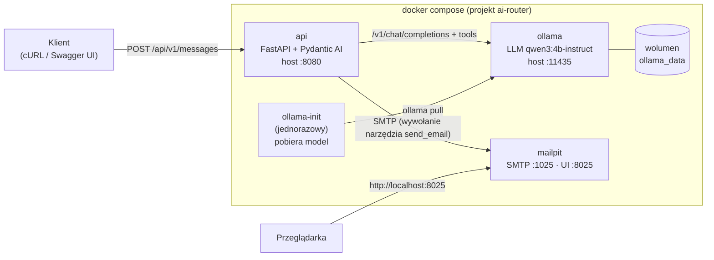
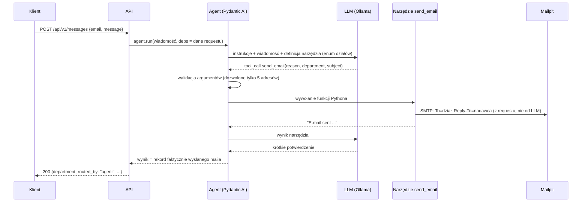

# AI Message Router — PoC

Inteligentny router wiadomości: API przyjmuje dowolne zgłoszenie użytkownika („Nie działa mi komputer”,
„Chciałbym zgłosić urlop na jutro”), **agent AI** oparty na lokalnym modelu językowym (Ollama) interpretuje
treść, wybiera właściwy dział i **sam wysyła e-mail, wywołując narzędzie `send_email`** (function calling).
Wiadomość trafia do przechwytującego serwera pocztowego **Mailpit** z nagłówkiem `Reply-To` ustawionym na
adres nadawcy.

| Dokument | Dla kogo |
|---|---|
| **README.md** (ten plik) | Uruchomienie, użycie, konfiguracja, decyzje, testy |
| [docs/DESIGN.md](docs/DESIGN.md) | Pełny projekt systemu (architektura, analiza ryzyk, alternatywy) |

---

## Spis treści

- [Architektura](#architektura)
- [Wymagania](#wymagania)
- [Szybki start](#szybki-start)
- [Przykładowe zapytania](#przykładowe-zapytania)
- [Weryfikacja w Mailpit](#weryfikacja-w-mailpit)
- [Jak działa agent](#jak-działa-agent)
- [Polityka routingu](#polityka-routingu)
- [Decyzje architektoniczne](#decyzje-architektoniczne)
- [API](#api)
- [Konfiguracja](#konfiguracja)
- [Testy i jakość](#testy-i-jakość)
- [Rozwiązywanie problemów](#rozwiązywanie-problemów)
- [Ograniczenia i rozszerzenia](#ograniczenia-i-rozszerzenia)
- [Struktura repozytorium](#struktura-repozytorium)

---

## Architektura



| Usługa | Obraz | Rola | Adres na hoście |
|---|---|---|---|
| `api` | `python:3.13-slim` (build z `api/Dockerfile`) | Endpoint HTTP, agent AI, Swagger | http://localhost:8080 |
| `ollama` | `ollama/ollama:0.40.3` | Lokalny silnik LLM (CPU; GPU opcjonalnie) | http://localhost:11435 (debug) |
| `ollama-init` | `ollama/ollama:0.40.3` | Jednorazowo pobiera model, jeśli go nie ma | — |
| `mailpit` | `axllent/mailpit:v1.31.5` | Przechwytuje e-maile, panel WWW, REST API | http://localhost:8025 |

Porty są publikowane tylko na `127.0.0.1`. API na hoście ma port **8080**, a nie 8000: 8000 bywa zajęty
przez inne serwery deweloperskie. Ollama ma port **11435**, żeby nie kolidować z Ollamą zainstalowaną
lokalnie (11434). Porty można zmienić w `.env` (patrz [Konfiguracja](#konfiguracja)).

## Wymagania

- Docker ≥ 24 i Docker Compose ≥ 2.24 (`docker compose version`)
- ≥ 8 GB RAM dostępnej dla Dockera (model zajmuje ok. 4 GB); na Docker Desktop zwiększ limit w ustawieniach
- ≥ 15 GB wolnego dysku: obraz Ollamy ok. 9 GB (zawiera biblioteki GPU), model ok. 2,5 GB
- Internet przy **pierwszym** uruchomieniu (kolejne działają offline)
- Opcjonalnie: `curl`, `jq`, `make` (wygodne skróty)

## Szybki start

```bash
git clone <adres-repozytorium> ai-router
cd ai-router
docker compose up -d
```

To wszystko. Pierwsze uruchomienie pobiera obrazy i model (ok. 2,5 GB). Polecenie **czeka**, aż model
będzie na dysku, i dopiero wtedy uruchamia API. Postęp pobierania podejrzysz w drugim terminalu:

```bash
docker compose logs -f ollama-init
```

Gdy polecenie się zakończy, API jest gotowe. Opcjonalnie możesz poczekać na pełną gotowość wszystkich
zależności:

```bash
./scripts/wait-ready.sh          # lub: make wait
```

| Co | Adres |
|---|---|
| Swagger UI (dokumentacja API) | http://localhost:8080/api/v1/docs |
| ReDoc | http://localhost:8080/api/v1/redoc |
| Specyfikacja OpenAPI | http://localhost:8080/api/v1/openapi.json |
| Panel Mailpit (przechwycone e-maile) | http://localhost:8025 |

Zatrzymanie: `docker compose down` (model zostaje w wolumenie). Pełny reset z usunięciem modelu:
`docker compose down -v`.

## Przykładowe zapytania

```bash
curl -s --max-time 200 -X POST http://localhost:8080/api/v1/messages \
  -H 'Content-Type: application/json' \
  -d '{"email": "jan.nowak@example.com", "message": "Nie działa mi komputer"}' | jq
```

Przykładowa odpowiedź (`200 OK`):

```json
{
  "request_id": "6b1f0c7e-3f2a-4d55-9a57-6f3e0d2b9c11",
  "status": "routed",
  "routed_by": "agent",
  "department": "help-desk@example.com",
  "reason": "Problem z jednym urządzeniem użytkownika",
  "email": {
    "message_id": "<179188829665.1.1234567890@ai-router.local>",
    "subject": "[AI Router] Komputer nie działa",
    "to": "help-desk@example.com",
    "reply_to": "jan.nowak@example.com"
  },
  "diagnostics": {
    "model": "qwen3:4b-instruct-2507-q4_K_M",
    "llm_requests": 2,
    "tool_calls": 1,
    "retries": 0,
    "input_tokens": 2804,
    "output_tokens": 60,
    "duration_ms": 8950
  },
  "warnings": []
}
```

Inne przykłady:

```bash
# -> kadry@example.com
curl -s --max-time 200 -X POST http://localhost:8080/api/v1/messages -H 'Content-Type: application/json' \
  -d '{"email": "anna.kowalska@example.com", "message": "Chciałbym zgłosić urlop na jutro"}' | jq '{department, reason}'

# -> it@example.com
curl -s --max-time 200 -X POST http://localhost:8080/api/v1/messages -H 'Content-Type: application/json' \
  -d '{"email": "piotr@example.com", "message": "Serwer z bazą danych nie odpowiada, cały dział stoi"}' | jq '{department, reason}'

# -> other@example.com
curl -s --max-time 200 -X POST http://localhost:8080/api/v1/messages -H 'Content-Type: application/json' \
  -d '{"email": "ewa@example.com", "message": "Gdzie mogę zaparkować rower?"}' | jq '{department, reason}'
```

Na CPU jedno zapytanie trwa zwykle **5–20 s** (pierwsze po starcie może trwać dłużej), stąd
`--max-time 200`. Opcjonalny nagłówek `Idempotency-Key: <klucz>` sprawia, że powtórzenie tego samego
zapytania nie wyśle drugiego maila.

## Weryfikacja w Mailpit

1. Otwórz http://localhost:8025. Wiadomość leży w skrzynce adresata (np. `help-desk@example.com`).
2. Po kliknięciu wiadomości zobaczysz odbiorcę `To`, a na zakładce **Headers** nagłówek
   `Reply-To: jan.nowak@example.com`. Są tam też nagłówki diagnostyczne `X-Request-ID` i `X-AI-Router-*`.

To samo z terminala, przez REST API Mailpit:

```bash
curl -s http://localhost:8025/api/v1/message/latest | jq '{To: .To[0].Address, ReplyTo: .ReplyTo[0].Address, Subject}'
```

Automatyczne sprawdzenie wszystkich kryteriów DoD (Swagger, dział, `Reply-To`, `X-Request-ID`):

```bash
./scripts/smoke-test.sh          # lub: make smoke  (wymaga curl i jq)
```

## Jak działa agent



Najważniejsze zasady:

- **Mail wysyła wyłącznie narzędzie agenta.** Model zwraca *prośbę* o wywołanie `send_email`, a aplikacja
  waliduje argumenty i wykonuje funkcję. Jeśli model odpowie samym tekstem, walidator wyjścia
  (`ModelRetry`) każe mu wywołać narzędzie.
- **LLM decyduje, kod wykonuje.** Model wybiera tylko dział (z enuma), temat i uzasadnienie.
  `Reply-To`, oryginalną treść i nadawcę wstawia kod z danych requestu, więc prompt injection nie może
  ich zmienić.
- **O wyniku decyduje faktycznie wysłany mail, a nie tekst modelu.** Odpowiedź API buduje się z rekordu
  zapisanego przez narzędzie.
- **Dokładnie jeden mail na request.** Narzędzie ma blokadę, więc ponowne lub równoległe wywołania niczego
  nie wysyłają.
- **Fallback.** Jeśli agent zawiedzie (LLM nie odpowiada, wyczerpane ponowienia, timeout), zgłoszenie
  nie ginie: trafia do `other@example.com` z jawnym oznaczeniem `routed_by: "fallback"` i nagłówkiem
  `X-AI-Router-Routed-By: fallback`. Fallback można wyłączyć (`ROUTING_FALLBACK_ENABLED=false`).

## Polityka routingu

Lista działów z zadania zawiera dwie pary nakładających się nazw: **HR / kadry** oraz **help-desk / IT**.
Projekt rozdziela je **funkcjonalnie**, niezależnie od języka wiadomości:

| Dział | Zakres | Przykład |
|---|---|---|
| `kadry@example.com` | administracja kadrowo-płacowa: urlopy, L4, czas pracy, wynagrodzenia, PIT-11, umowy, zaświadczenia | „Chciałbym zgłosić urlop na jutro” |
| `human-resources@example.com` | HR „ludzki”: rekrutacja, onboarding, szkolenia, benefity, oceny, konflikty, mobbing, dobrostan | „Jakie szkolenia są dostępne?” |
| `help-desk@example.com` | wsparcie pierwszej linii dla **jednej osoby**: jej komputer, drukarka, hasło, konto, Outlook | „Nie działa mi komputer” |
| `it@example.com` | infrastruktura i systemy: awarie dotykające wielu osób, bezpieczeństwo (phishing), uprawnienia do systemów, wdrożenia, licencje | „Serwer nie odpowiada, cały dział stoi” |
| `other@example.com` | treści niejasne, puste, niezwiązane z działami, spam (fallback) | „Gdzie mogę zaparkować rower?” |

Politykę definiuje jedno miejsce: [api/src/ai_router/routing/departments.py](api/src/ai_router/routing/departments.py).
Z niego generowane są instrukcje agenta, schemat narzędzia i opis w Swaggerze.

## Decyzje architektoniczne

| # | Decyzja | Uzasadnienie (skrót) |
|---|---|---|
| D1 | **Python 3.13 + FastAPI** | Najbogatszy ekosystem AI; Swagger/OpenAPI generowany automatycznie z modeli Pydantic; asynchroniczne I/O pasuje do długich wywołań LLM i SMTP. |
| D2 | **Pydantic AI** jako framework agenta | Typowane zależności (`deps`) wstrzykiwane do narzędzi, walidacja argumentów narzędzi z automatycznym odesłaniem błędu do modelu, walidatory wyjścia, limity, modele testowe (`FunctionModel`) do testów bez LLM. Mniej abstrakcji niż LangChain. |
| D3 | **Mailpit** zamiast MailHog | MailHog nie jest rozwijany od 2020 r. i nie ma obrazu arm64. Mailpit jest aktywny, ma wbudowany healthcheck i REST API do testów. Porty są identyczne (1025/8025). |
| D4 | **Init-kontener `ollama-init`** | `docker compose up -d` czeka na wagi modelu (`service_completed_successfully`); skrypt jest idempotentny i nie łączy się z rejestrem, gdy model już jest (działa offline). |
| D5 | Model **`qwen3:4b-instruct-2507-q4_K_M`** | Tool calling, dobry polski, wariant bez trybu „thinking” (przewidywalne opóźnienie na CPU), 2,5 GB; przypięty tag. Zmiana modelu to jedna zmienna. |
| D6 | **Dział jako enum w schemacie narzędzia** | Model widzi listę dozwolonych adresów; halucynacje (np. `support@…`) odrzuca walidacja i wracają do modelu do poprawy. |
| D7 | **`Reply-To` i treść oryginalna z kodu** | Odporność na literówki modelu i prompt injection. |
| D8 | **`@agent.tool` + walidator wyjścia** | Kanoniczny wzorzec „agent używa narzędzia”, dosłownie zgodny z wymaganiem. Wysyłka w kodzie po klasyfikacji łamałaby wymaganie. |
| D9 | **Synchroniczne API** | Natychmiastowa informacja zwrotna (dział, `Message-ID`). Przed przeciążeniem chronią semafor (HTTP 429) i timeouty. |
| D10 | **Jawny fallback do `other@`** | Zgłoszenie nie ginie przy awarii LLM i jest wyraźnie oznaczone. |
| D11 | **`uv` + `uv.lock`** | Szybkie, powtarzalne buildy; obraz bazowy to wciąż oficjalny `python`. |
| D12 | **Funkcjonalny podział działów** | Ta sama decyzja niezależnie od języka zgłoszenia. |

Wnioski z testów na prawdziwym modelu:

- **Schemat narzędzia musi być płaski.** Pydantic opisuje enum przez `$ref`/`anyOf`/`const`, a parser
  narzędzi Ollamy tych pól nie obsługuje: lista działów po cichu znikała, zanim dotarła do modelu.
  Schemat wymuszamy jako `{"type": "string", "enum": [...]}`.
- **Ollama ignoruje `max_completion_tokens`.** Pydantic AI wysyła domyślnie ten nowszy parametr; bez
  nadpisania profilu modelu limit tokenów nie działał.
- **„Nie rób X” potrafi wywołać X.** Reguła „never call `send_email` more than once” sprawiała, że model
  4B emitował to samo wywołanie w pętli. Gwarancję „dokładnie raz” zapewnia kod, nie prompt.
- **Bez polityki routingu model myli działy.** Bez instrukcji model wysłał „Nie działa mi komputer” do
  `it@`, z polityką trafia do `help-desk@`.

## API

| Metoda i ścieżka | Opis |
|---|---|
| `POST /api/v1/messages` | Kategoryzacja i przekazanie wiadomości. Body: `{"email": "...", "message": "..."}` |
| `GET /api/v1/health/live` | Liveness: proces działa |
| `GET /api/v1/health/ready` | Readiness: Ollama, model i SMTP osiągalne (używane przez healthcheck Dockera) |
| `GET /api/v1/docs` · `/api/v1/redoc` · `/api/v1/openapi.json` | Dokumentacja |

Błędy mają format **RFC 9457 Problem Details** (`application/problem+json`) z polem `request_id`:

| Kod | Kiedy |
|---|---|
| 422 | Niepoprawne dane (zły e-mail, pusta lub za długa wiadomość, znak NUL), konflikt `Idempotency-Key` |
| 413 | Ciało requestu > 64 KB |
| 429 | Wszystkie sloty agenta zajęte (nagłówek `Retry-After`) |
| 502 | Agent nie wysłał maila, a fallback jest wyłączony |
| 503 | LLM albo SMTP niedostępny (przy niedostępnym SMTP fallback też nie pomoże) |
| 504 | Przekroczony czas agenta, a fallback jest wyłączony |

Każda odpowiedź ma nagłówek `X-Request-ID`, który wraca też w nagłówku maila i w logach. Można go podać
własny.

## Konfiguracja

Plik `.env` jest **opcjonalny**: wszystkie zmienne mają wartości domyślne. Pełna lista z opisami:
[.env.example](.env.example). Najczęściej zmieniane:

| Zmienna | Domyślnie | Opis |
|---|---|---|
| `OLLAMA_MODEL` | `qwen3:4b-instruct-2507-q4_K_M` | Model; po zmianie `docker compose up -d` sam go pobierze |
| `API_PORT` / `MAILPIT_UI_PORT` / `OLLAMA_PORT` | `8080` / `8025` / `11435` | Porty na hoście |
| `OLLAMA_CONTEXT_LENGTH` | `8192` | Okno kontekstu (domyślne 4096 w Ollamie grozi cichym obcięciem promptu) |
| `ROUTING_FALLBACK_ENABLED` | `true` | Fallback do `other@example.com` przy awarii agenta |
| `MAX_MESSAGE_CHARS` | `4000` | Limit długości wiadomości |
| `LLM_THINKING` | puste | Ustaw `false` dla modeli hybrydowych (np. `qwen3.5:4b`) |
| `LOG_FORMAT` | `json` | `console` dla czytelnych logów lokalnie |

Zmiana modelu, np. na nowszy `qwen3.5:4b`:

```bash
echo -e "OLLAMA_MODEL=qwen3.5:4b\nLLM_THINKING=false" >> .env
docker compose up -d        # ollama-init pobierze nowy model, api wystartuje z nim
```

**GPU (NVIDIA)**: `docker compose -f docker-compose.yml -f docker-compose.gpu.yml up -d` (wymaga NVIDIA
Container Toolkit). **AMD**: ustaw `OLLAMA_VERSION=0.40.3-rocm` i przekaż urządzenia `/dev/kfd` oraz
`/dev/dri` (patrz dokumentacja Ollamy). Na Apple Silicon kontenery nie mają dostępu do GPU, więc model
działa na CPU.

## Testy i jakość

Wszystko działa w kontenerze deweloperskim (profil `dev`), więc na hoście nie potrzebujesz Pythona ani `uv`:

| Komenda | Co robi | Wymaga działającego stosu |
|---|---|---|
| `make test` | 93 testy jednostkowe i API na skryptowanym modelu (bez LLM i sieci), ok. 3 s | nie |
| `make lint` | `ruff` (lint + format) i `mypy --strict` | nie |
| `make test-integration` | Wysyłka SMTP do prawdziwego Mailpit i asercje przez jego API | tak |
| `make test-llm` | Agent na prawdziwym modelu (3 jednoznaczne przypadki) | tak |
| `make e2e` | Testy DoD end-to-end przez HTTP (API → Ollama → Mailpit) | tak |
| `make smoke` | To samo w bashu (curl + jq), czytelny raport PASS/FAIL | tak |
| `make eval` | Ewaluacja trafności na 58 opisanych przypadkach, raport w `eval-results/` | tak |

**Wynik ewaluacji** modelu domyślnego (CPU, 16 rdzeni): po jednej iteracji strojenia promptu
**100% trafności** na zbiorze strojeniowym (48/48) i na nietkniętym zbiorze kontrolnym *holdout*
(10/10). Agent sam wysłał mail w 100% przypadków, mediana czasu odpowiedzi to 9,4 s (p95 12,6 s).
Przed strojeniem trafność wynosiła 95,8%. Raporty są w [eval-results/](eval-results/).
58 przypadków to mały
zbiór, więc na prawdziwych wiadomościach błędy się zdarzą. Na ten wypadek są fallback, nagłówki
diagnostyczne i uzasadnienie (`reason`) w każdym mailu.

## Rozwiązywanie problemów

| Objaw | Rozwiązanie |
|---|---|
| `docker compose up -d` długo „wisi” przy pierwszym uruchomieniu | To pobieranie modelu: `docker compose logs -f ollama-init` |
| `port is already allocated` | Zmień port w `.env`, np. `API_PORT=8090` |
| `ollama-init` kończy się błędem | Brak internetu albo błędny tag modelu; sprawdź `docker compose logs ollama-init` |
| Odpowiedzi trwają bardzo długo | CPU jest wolne dla LLM; sprawdź obciążenie (`docker stats`), rozważ GPU lub mniejszy model |
| Ollama jest zabijana / brak pamięci | Przydziel Dockerowi ≥ 8 GB RAM (Docker Desktop → Resources) |
| `routed_by: "fallback"` w odpowiedzi | Agent zawiódł; przyczyna jest w `warnings`, szczegóły w `docker compose logs api` |
| Pusta strona Swaggera | Swagger UI ładuje skrypty z CDN, więc przeglądarka potrzebuje internetu |
| `/bin/sh^M: not found` w `ollama-init` (Windows) | Końce linii CRLF: `git config core.autocrlf false` i ponowne klonowanie |
| Readiness 503 | `curl -s localhost:8080/api/v1/health/ready \| jq` pokaże, która zależność nie działa |

## Ograniczenia i rozszerzenia

Świadome ograniczenia PoC: synchroniczne przetwarzanie, stan (semafor, idempotencja) w pamięci procesu,
brak uwierzytelniania klientów API, Mailpit bez trwałego wolumenu (restart czyści skrzynkę), mały model
może się mylić w przypadkach naprawdę niejednoznacznych.

Możliwe rozszerzenia: tryb asynchroniczny (kolejka + `202 Accepted`), routing do wielu działów, próg
pewności z weryfikacją przez człowieka, tracing (OpenTelemetry + Arize Phoenix), wystawienie narzędzia
jako serwera MCP, trwała baza zgłoszeń. Więcej: [docs/DESIGN.md §20](docs/DESIGN.md#20-możliwe-rozszerzenia).

## Struktura repozytorium

```text
.
├── docker-compose.yml          # pełne środowisko (+ docker-compose.gpu.yml dla NVIDIA)
├── .env.example                # wszystkie zmienne konfiguracyjne (plik .env jest opcjonalny)
├── Makefile                    # make help - skróty: up, test, e2e, eval, lint...
├── scripts/                    # ollama-init.sh, wait-ready.sh, smoke-test.sh
├── docs/                       # DESIGN.md
├── eval-results/               # raporty ewaluacji jakości
└── api/
    ├── Dockerfile              # multi-stage: runtime (produkcja) i dev (testy)
    ├── pyproject.toml, uv.lock
    ├── src/ai_router/
    │   ├── main.py             # fabryka aplikacji FastAPI
    │   ├── container.py        # składanie komponentów (dependency injection)
    │   ├── config.py           # konfiguracja ze zmiennych środowiskowych
    │   ├── routing/            # polityka działów, prompty, AGENT, serwis (fallback, limity)
    │   ├── mail/               # kompozycja maila (Reply-To) i wysyłka SMTP
    │   ├── llm/                # model Ollama (Pydantic AI) i natywne API (health, rozgrzewka)
    │   └── web/                # endpointy, schematy, błędy, middleware, idempotencja
    └── tests/                  # unit, api, integration, e2e, eval
```
